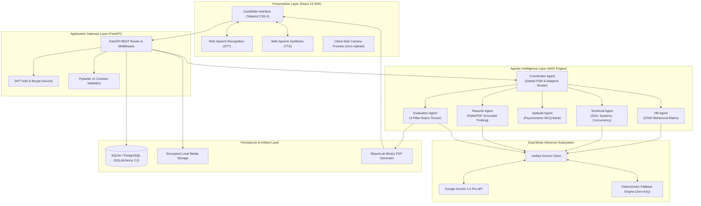
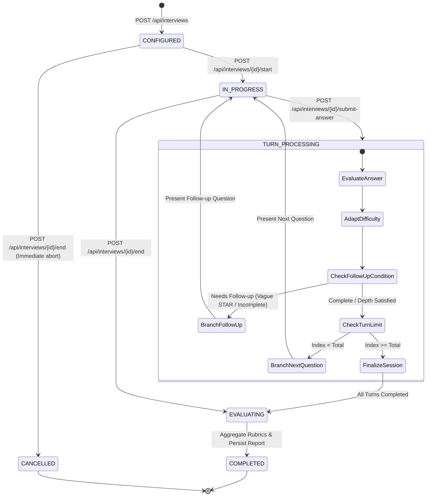
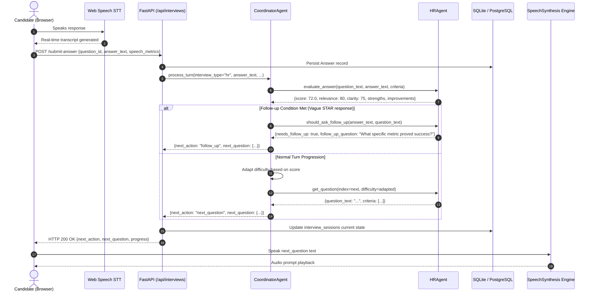
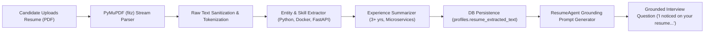

# Multi-Agent Architecture & Inter-Agent Coordination Protocol

**Author:** Master Orchestrator & Research Engineering Team  
**Project:** InterviewGenie AI  
**Academic Module:** Section 05 — Technical Architecture & State Machine Formalization  
**Date:** November 2026  

---

## 1. System Architectural Topology

InterviewGenie AI is architected as a decoupled, multi-tiered software ecosystem combining a reactive single-page client, a high-throughput asynchronous REST gateway, and a decentralized multi-agent cognitive engine.

```
+-------------------------------------------------------------------------------------------------+
|                                 PRESENTATION LAYER (Frontend SPA)                               |
|   React 19 | Vite | TypeScript | Tailwind CSS | Web Speech Recognition API | SpeechSynthesis    |
+------------------------------------------------+------------------------------------------------+
                                                 | HTTPS / REST / WebSockets
                                                 v
+-------------------------------------------------------------------------------------------------+
|                          APPLICATION & ROUTING LAYER (FastAPI Backend)                          |
|   FastAPI REST API | Pydantic v2 Validation | JWT Security & RBAC | SQLAlchemy 2.0 ORM Engine   |
|   Endpoints: /api/auth, /api/profile, /api/interviews, /api/aptitude, /api/media                |
+------------------------------------------------+------------------------------------------------+
                                                 | Internal Python Method Dispatch
                                                 v
+-------------------------------------------------------------------------------------------------+
|                             AGENTIC INTELLIGENCE LAYER (MAS Engine)                             |
|                                                                                                 |
|   +-----------------------------------------------------------------------------------------+   |
|   |                            Coordinator Agent (Global FSM)                               |   |
|   +----+--------------------+--------------------+--------------------+---------------------+   |
|        |                    |                    |                    |                         |
|   +----v-------+       +----v-------+       +----v-------+       +----v-------+       +-------v---+ |
|   |  HR Agent  |       | Tech Agent |       |  Aptitude  |       |Resume Agent|       |Evaluation | |
|   | (STAR HR)  |       | (DSA/Sys)  |       | (MCQ Bank) |       |(PyMuPDF)   |       |Agent (PDF)| |
|   +----+-------+       +----+-------+       +----+-------+       +----+-------+       +-------+---+ |
|        |                    |                    |                    |                       |     |
|        +--------------------+--------------------+--------------------+-----------------------+     |
|                                                  |                                                  |
|                        +-------------------------v-------------------------+                        |
|                        |             Unified Gemini Client                 |                        |
|                        |   Live Gemini 1.5 Pro  <--->  Deterministic Fallback|                       |
|                        +---------------------------------------------------+                        |
+------------------------------------------------+------------------------------------------------+
                                                 |
                                                 v
+-------------------------------------------------------------------------------------------------+
|                            PERSISTENCE & ARTIFACT LAYER (Storage)                               |
|   SQLite / PostgreSQL Database | Local Encrypted Media Storage | ReportLab PDF Engine           |
+-------------------------------------------------------------------------------------------------+
```

### High-Level Multi-Tier Flowchart



---

## 2. Finite State Machine (FSM) Formalization

The interview session lifecycle is governed strictly by a deterministic Finite State Machine (FSM) embedded within `CoordinatorAgent` and persisted in the `interview_sessions` relational model.

Formally, the FSM is defined as:

$$\mathcal{M} = \langle \mathcal{S}, \Sigma, \delta, s_0, \mathcal{F} \rangle$$

Where:
- $\mathcal{S} = \{\text{CONFIGURED}, \text{IN\_PROGRESS}, \text{TURN\_PROCESSING}, \text{EVALUATING}, \text{COMPLETED}, \text{CANCELLED}\}$
- $\Sigma = \{\text{INIT}, \text{START}, \text{SUBMIT\_ANSWER}, \text{FOLLOW\_UP\_TRIGGERED}, \text{ADVANCE\_QUESTION}, \text{TERMINATE}, \text{ABORT}\}$
- $s_0 = \text{CONFIGURED}$
- $\mathcal{F} = \{\text{COMPLETED}, \text{CANCELLED}\}$



### Table 1: State Transition Matrix

| Current State ($\mathcal{S}_t$) | Input Event ($\Sigma$) | Guard Condition | Next State ($\mathcal{S}_{t+1}$) | Output Action |
| :--- | :--- | :--- | :--- | :--- |
| `CONFIGURED` | `START` | Session exists & user authorized | `IN_PROGRESS` | Fetch initial question from domain agent; set `started_at = now()`. |
| `IN_PROGRESS` | `SUBMIT_ANSWER` | Valid `question_id` & non-empty transcript | `TURN_PROCESSING` | Trigger domain evaluation; update running metrics. |
| `TURN_PROCESSING` | `FOLLOW_UP_TRIGGERED` | Response brief/vague AND `is_follow_up == False` | `IN_PROGRESS` | Inject follow-up question; retain question index $q_i$. |
| `TURN_PROCESSING` | `ADVANCE_QUESTION` | Answer complete AND $q_i + 1 < N_{\text{total}}$ | `IN_PROGRESS` | Increment index $q_{i+1}$; fetch next domain question at adapted difficulty. |
| `TURN_PROCESSING` | `FINALIZE_SESSION` | Answer complete AND $q_i + 1 \ge N_{\text{total}}$ | `EVALUATING` | Transition session to evaluation mode. |
| `IN_PROGRESS` | `TERMINATE` | Explicit user end command | `EVALUATING` | Early exit; process evaluations for answered questions. |
| `EVALUATING` | `AGGREGATE` | Evaluations present | `COMPLETED` | Execute `aggregate_evaluation()`; write `evaluation_reports` record. |

---

## 3. Dynamic Difficulty Adaptation Engine

A key contribution of the InterviewGenie AI architecture is the closed-loop difficulty adaptation mechanism. Rather than exposing a static test, the system updates its internal difficulty estimation after each turn $t$:

```
                        +---------------------------+
                        |  Candidate Answer Score   |
                        |      (0.0 to 100.0)       |
                        +-------------+-------------+
                                      |
                     +----------------+----------------+
                     |                                 |
              Score >= 85.0                      Score < 60.0
                     |                                 |
                     v                                 v
        +-------------------------+       +-------------------------+
        | Adapted Difficulty:     |       | Adapted Difficulty:     |
        |        "HARD"           |       |        "EASY"           |
        | Advanced Concurrency,   |       | Syntax, Core Principles,|
        | Distributed Bottlenecks |       | Guided Problem Solving  |
        +-------------------------+       +-------------------------+
                     \                                 /
                      \                               /
                       +--------------+--------------+
                                      | 60.0 <= Score < 85.0
                                      v
                         +-------------------------+
                         | Adapted Difficulty:     |
                         |       "MEDIUM"          |
                         | Standard Architecture,  |
                         | Common Trade-offs       |
                         +-------------------------+
```

Mathematically, given current answer score $S_t \in [0, 100]$:

$$\mathcal{D}_{t+1} = \psi(S_t) = \begin{cases} 
\text{"hard"}, & S_t \ge 85.0 \\ 
\text{"medium"}, & 60.0 \le S_t < 85.0 \\ 
\text{"easy"}, & S_t < 60.0 
\end{cases}$$

When the next question is fetched:
$$\mathcal{Q}_{t+1} = \text{Agent}_{\text{domain}}.\text{get\_question}(\text{domain}, \text{index} = t+1, \text{difficulty} = \mathcal{D}_{t+1})$$

---

## 4. End-to-End Inter-Agent Execution Sequences

### 4.1 Turn Processing and Follow-Up Probing Sequence
The sequence diagram below illustrates the exact runtime message exchange during a candidate turn, highlighting the branching logic between follow-up questions and next-topic progression.



---

## 5. Resume Extraction and Context Grounding Pipeline

The `ResumeAgent` is engineered to eliminate generic questions by anchoring prompts directly to the candidate's authentic professional history.



---

## 6. Offline Resilience and Failover Architecture

In production and high-stakes test environments, network interruptions or LLM API quota exhaustion must not cause system crash or conversational stall.

InterviewGenie AI incorporates a **Dual-Mode Inference Engine** within `GeminiClient`:
1. **Online Mode (Google GenAI SDK):** Interacts with `gemini-1.5-pro` via asynchronous TLS calls, enforcing structured JSON parsing via `clean_json_response()`.
2. **High-Fidelity Deterministic Fallback Mode:** Automatically activated when:
   - `GEMINI_API_KEY` is omitted or empty.
   - Network connectivity is disrupted.
   - API rate limits (HTTP 429) or remote server errors (HTTP 500) occur.

The deterministic fallback engine evaluates keyword overlap, length heuristics, and technical criterion tokens, returning structured JSON schemas identical to live model responses. This ensures that:
- Automated CI/CD test pipelines run with 100% determinism and zero external network dependencies.
- Candidate sessions never drop abruptly midway through an interview.

---

## 7. Client-Side Audio Synchronization & Anti-Echo Protocol

A known failure mode in conversational voice agents is **acoustic feedback loop**, where the AI's synthesized voice output is picked up by the microphone and transcribed as candidate speech.

InterviewGenie AI implements an **Acoustic Turn-Taking Lock** in the browser presentation layer:
1. When AI speech synthesis (`window.speechSynthesis.speak`) is active:
   - Microphone recognition (`webkitSpeechRecognition.stop()`) is programmatically suspended.
   - UI microphone indicators switch to `MUTED_AI_SPEAKING`.
2. Upon synthesis termination event (`onend`):
   - A 300ms acoustic dampening delay is observed.
   - Microphone recognition (`webkitSpeechRecognition.start()`) is resumed.
3. This eliminates self-transcription and maintains clean transcript integrity.

---

## 8. Related Project Documentation

- [01_PROBLEM_STATEMENT.md](file:///C:/Users/saksham%20nagar/InterviewGenie-AI/docs/01_PROBLEM_STATEMENT.md) — Problem Formulation and Systemic Objectives
- [02_LITERATURE_REVIEW.md](file:///C:/Users/saksham%20nagar/InterviewGenie-AI/docs/02_LITERATURE_REVIEW.md) — Theoretical Foundations & Academic Survey
- [03_RESEARCH_GAP.md](file:///C:/Users/saksham%20nagar/InterviewGenie-AI/docs/03_RESEARCH_GAP.md) — Comparative Analysis Against Existing Systems
- [04_PEAS_FRAMEWORK.md](file:///C:/Users/saksham%20nagar/InterviewGenie-AI/docs/04_PEAS_FRAMEWORK.md) — Russell & Norvig PEAS Multi-Agent Specification
- [06_RESPONSIBLE_AI_AND_PRIVACY.md](file:///C:/Users/saksham%20nagar/InterviewGenie-AI/docs/06_RESPONSIBLE_AI_AND_PRIVACY.md) — Anti-Bias Architecture & GDPR Sovereignty
- [07_EXPERIMENTAL_RESULTS_AND_EVALUATION.md](file:///C:/Users/saksham%20nagar/InterviewGenie-AI/docs/07_EXPERIMENTAL_RESULTS_AND_EVALUATION.md) — Benchmarks & Empirical Reliability
- [08_USER_GUIDE_AND_DEMO_SCRIPT.md](file:///C:/Users/saksham%20nagar/InterviewGenie-AI/docs/08_USER_GUIDE_AND_DEMO_SCRIPT.md) — Operational Manual & Academic Viva Defense Protocol
